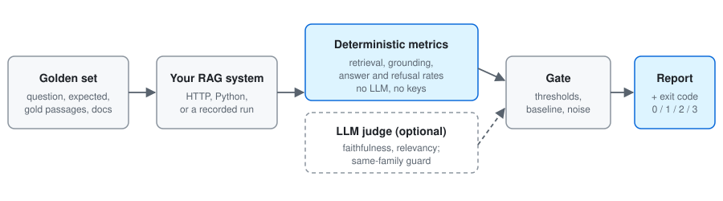
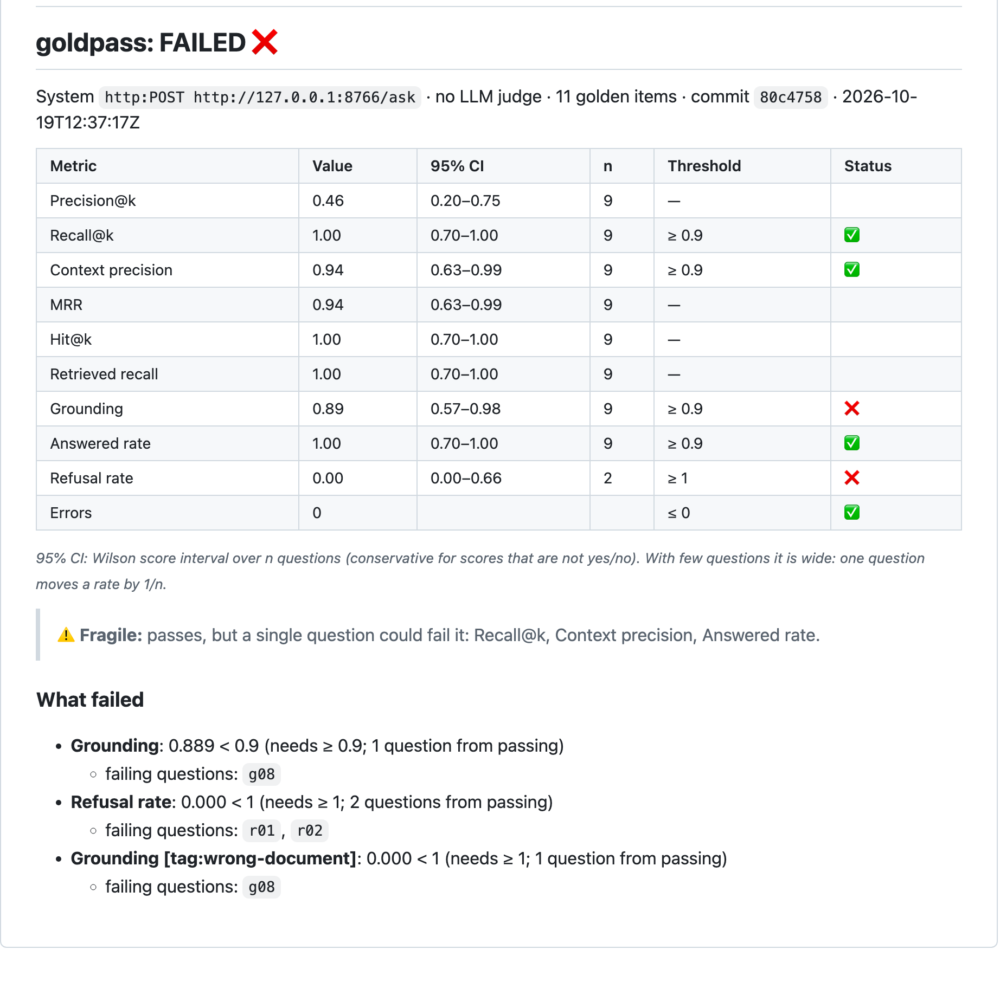

# goldpass

[](https://github.com/cardohso/goldpass/actions/workflows/ci.yml)
[](https://github.com/cardohso/goldpass/actions/workflows/e2e.yml)

[](LICENSE)

**Regression tests for RAG systems.** Write down the questions your system must answer, the
passages and documents that support each answer, and the questions it must refuse. goldpass
asks your system those questions over HTTP or in Python, scores what comes back, and fails
the CI job when retrieval, grounding or refusals get worse, naming the questions that broke.

- **Free and deterministic by default.** Retrieval, grounding and answer/refusal metrics need no
  LLM, no API key and no network.
- **LLM judges are optional.** They work with any OpenAI-compatible API, and a guard refuses
  to gate on a judge from the generator's own model family.
- **One composite GitHub Action** that writes the report to the job summary.

<p align="center">
  
</p>

It is the generic half of the evaluation gate in
[rail-regulation-rag](https://github.com/cardohso/rail-regulation-rag), and it reproduces that
gate's numbers exactly (see [below](#parity-with-the-system-it-came-from)).

> **Status: 0.1.0, alpha.** Not on PyPI yet. Read [Limitations](#limitations) before
> relying on it.

## Quickstart

From a clone, against the bundled fake RAG service (no keys, no network):

```bash
git clone https://github.com/cardohso/goldpass && cd goldpass && uv sync

# a healthy fake service: the gate passes, exit code 0
uv run python examples/fake_rag/server.py --port 8765 &
uv run goldpass run --config examples/fake_rag/goldpass.yaml

# a regressed one: the gate fails, exit code 1
uv run python examples/fake_rag/server.py --port 8766 --mode regressed &
uv run goldpass run --config examples/fake_rag/goldpass.yaml \
  --url http://127.0.0.1:8766/ask
```

In your own repo's CI:

```yaml
- uses: cardohso/goldpass@v0
  with:
    config: eval/goldpass.yaml   # your system, golden set, thresholds and baseline
```

```yaml
# eval/goldpass.yaml
golden: golden.jsonl
thresholds: thresholds.yaml
system:
  type: http
  url: http://localhost:8000/ask          # or type: python, target: "my_rag.app:ask"
  fields: {answer: data.text, contexts: data.sources, passage: {id: chunk_id}}
```

## The golden set

One JSON object per line, checked by a [JSON Schema](src/goldpass/schemas/golden-item.schema.json)
(`goldpass validate golden.jsonl`):

```json
{"id": "g08", "question": "What is the size limit for a single object upload?", "expected": "answer",
 "gold_passage_ids": ["limits#2"], "source_doc_ids": ["limits"], "tags": ["wrong-document"]}
{"id": "r01", "question": "What is the phone number for customer support?", "expected": "refuse"}
```

`expected` is `answer` or `refuse`. `gold_passage_ids` feed the retrieval metrics and
`source_doc_ids` feed grounding. `tags` let you set thresholds per slice, for example on questions
that a near-identical passage in another document could mislead. `reference_answer`, `notes` and
`metadata` are optional. Unknown fields are errors, so a typo cannot silently switch a metric off.
Full reference: [docs/configuration.md](docs/configuration.md).

## What it measures

| | Metrics | Needs |
|---|---|---|
| Retrieval | precision@k, recall@k, context precision, MRR, hit@k, retrieved recall | the ranked passage ids the system used |
| Grounding | every cited document is one the question is about | citations with document ids |
| Behaviour | answered rate on `answer` questions, refusal rate on `refuse` questions, errors | a refusal flag, or regexes on the answer |
| Judge (optional) | faithfulness (claims checked against contexts), answer relevancy (1–5 rubric) | an OpenAI-compatible API key |

A metric that cannot be measured for a question (no gold ids, or the system does not report its
contexts) is skipped with a stated reason, never scored 0. Every average comes with its `n`.
Definitions: [docs/metrics.md](docs/metrics.md). Judges and the guard:
[docs/judges.md](docs/judges.md).

## What a failure looks like

This is the job summary from the last command in the quickstart (abridged; written to
`examples/fake_rag/goldpass-results/run.md`). The fake service's `regressed` mode drops a
filter that hid an outdated page and removes its refusal threshold:



*The Markdown goldpass wrote (`run.md`), rendered with GitHub's Markdown API and screenshotted
locally; it is not a capture of the live job-summary page. `docs/images/README.md` says how to
redo it.*

Retrieval still looks perfect: recall@k is 1.00. The regression only shows up as the system
citing the wrong document and answering questions it should refuse. Those two checks exist for
exactly this case. With `baseline:` set, the report adds baseline and Δ columns, counts the
questions that got worse and better, and lists the ones that got worse.

Note the intervals: with 9 questions, a perfect 1.00 only shows the true rate is above 0.70, and
three passing checks are one question away from failing. See
[docs/metrics.md](docs/metrics.md#small-samples).

## Parity with the system it came from

`examples/rail/` holds a recorded CI run of rail-regulation-rag
([run 38838060201](https://github.com/cardohso/rail-regulation-rag/actions/runs/38838060201)):
the ids it retrieved and cited for its 20 golden questions, without answer or passage texts.
goldpass computes the same judge-free metrics as the rail repo's own gate
(`uv run pytest tests/test_rail_parity.py`):

| Rail metric | Rail gate | goldpass |
|---|---|---|
| context precision | 0.9375 | 0.9375 |
| context recall (`recall_at_k`) | 0.8854 | 0.8854 |
| grounding | 1.0 | 1.0 |
| answered rate | 0.9375 | 0.9375 |
| refusal rate | 1.0 | 1.0 |
| retrieval recall@k (`retrieved_recall`) | 0.9062 | 0.9062 |
| grounding on `wrong-document` questions | 1.0 | 1.0 |

`goldpass run --config examples/rail/goldpass.yaml` gates that run with the rail repo's
thresholds and against a committed baseline. `examples/rail/live.yaml` (and the manual
`rail-live` workflow) gates the live demo. The demo's API returns no retrieved passages, so
only grounding and answer/refusal rates are gated there. The first manual run
([39177557610](https://github.com/cardohso/goldpass/actions/runs/39177557610), 2026-10-18) passed:
grounding 1.00 (n=16), answered rate 1.00 (n=16), refusal rate 1.00 (n=4), 0 errors, with
retrieval metrics skipped on the 16 `answer` questions.

## Is the judge any good?

`goldpass judge-audit` plants one unsupported claim in copies of real answers (a changed number,
or an appended sentence) and counts how often each judge still scores the copy as faithful as
the original. On the 15 answered questions of the recorded rail run (28 planted errors;
reproduce with no keys: `goldpass judge-audit --config examples/rail/audit/goldpass.yaml --offline`):

| Judge | Family | Missed | Miss rate (95% CI) | Mean drop in faithfulness |
|---|---|---|---|---|
| Groq `openai/gpt-oss-120b` | openai | 0 of 28 | 0.00 (0.00–0.12) | 0.49 |
| Gemini `gemini-3.5-flash-lite` | google, **the model that wrote the answers** | 1 of 28 | 0.04 (0.01–0.18) | 0.43 |

Both judges scored all 15 unmodified answers 1.00. The only miss was an appended "It started as a
voluntary pilot…" sentence that the same-model judge let through; an exact McNemar test on the
paired results gives p = 1.00. So on errors this blunt, with 28 of them, there is **no detectable
self-preference, and the test cannot rule one out**: the miss-rate intervals reach 0.12 and
0.18. Subtler planted errors and more questions are the next step.

The audit also audited itself: in the first run, one planted "error" changed "speed greater than
250 km/h" to "greater than 260 km/h", which the passage still implies, and the judge correctly
accepted it. Numbers after lower-bound conditions are now never changed.

## Design decisions

- **Deterministic first.** Gold passage and document ids make retrieval and grounding
  measurable without an LLM, so the default gate is free, fast and reproducible, and a failure
  is a fact rather than a judge's opinion.
- **"Not reported" is not "zero".** `contexts: null` skips retrieval metrics; `contexts: []`
  scores 0. The same goes for refusals: a retrieval-only system declares `refused: null` and gets no
  answered rate, instead of a made-up 1.00. Skips are counted and explained, and `min_n` stops a
  gate passing on almost nothing.
- **Grounding by document, not by text overlap.** In a corpus of similar documents, a plausible
  answer often exists in the wrong one (the rail golden set has three such traps, for example
  train door widths in one regulation and tunnel door widths in another). An answer drawn from
  the wrong passage can still score well on retrieval and look faithful to its contexts. A
  document-level citation check catches it, and `wrong-document` tags make it a gated slice.
- **Honest about small samples.** A golden set of 20 questions moves 0.05 per question.
  Every rate gets a 95% Wilson interval, every check says how few questions would flip it, and
  baseline drops come with an exact sign test. `baseline.alpha` can require a drop to be
  significant before it fails, at the cost of letting single-question regressions through.
- **Two stages.** Answers are collected once and saved (`*.answers.json`), then scored. Judging,
  re-judging with another model, and baseline comparison work from saved answers without calling
  the system again.
- **Judges must differ in family from the generator.** LLM judges favour their own family's
  outputs (self-preference bias), so a same-family gating judge is refused unless explicitly
  overridden, and the override is printed on the report. Extra judges are shown side by side.
- **Built for free tiers.** One call at a time by default; optional workers share one request
  pace, and a `Retry-After` pauses all of them. Backoff, and a disk cache so re-runs cost
  nothing.
- **Small surface.** Three runtime dependencies (httpx, PyYAML, jsonschema). No LLM SDKs and no
  RAGAS, so nothing breaks when a provider's SDK changes.

## Limitations

What is synthetic, untested or simplified, stated plainly:

- **The fake RAG service is synthetic.** Its corpus documents a product that does not exist, and
  its "generator" quotes the best passage. It exists to show the gate passing and failing,
  not as a benchmark.
- **The judges are validated only on simple planted errors.** `judge-audit` shows both tested
  judges catch 27–28 of 28 mechanical errors on real rail answers (see above). Agreement with
  human labels, and with subtler unsupported claims, has not been measured.
- **Answer relevancy is a rubric, not RAGAS' embedding metric.** Its numbers are not comparable
  with RAGAS'.
- **Model families are inferred from model names** with a short pattern list. Unknown names
  are refused rather than guessed; set `family:` for them.
- **Concurrency is opt-in and thread-based.** The default is sequential. Workers overlap
  latency but never beat an API's rate limit, so a golden set that needs more requests than the
  limit allows is still slow.
- **JSON over HTTP only.** No streaming responses, no auth flows beyond static headers.
- **Platforms.** CI runs the tests on Ubuntu (Python 3.11 and 3.12), Windows and macOS (3.12), and
  the Action on a recorded run on all three. The Action's live-service path is tested on Ubuntu
  only.
- **Alpha.** The interface may change before 1.0. Not on PyPI, so install from a clone or
  `uv tool install git+https://github.com/cardohso/goldpass@v0.1.0`.

## Next steps

- Harder planted errors for `judge-audit` (swapped conditions, wrong document cited, partial
  answers), and judge agreement with human labels on a labelled answer set.
- An optional RAGAS-backed judge for teams that want RAGAS-comparable numbers.
- Publish to PyPI.

## Development

```bash
uv sync
uv run pytest          # offline: fake HTTP servers and a fake LLM API, no keys
uv run ruff check . && uv run ruff format --check . && uv run mypy
```

CI also runs on Windows and macOS and requires 90% coverage (currently 96%, from `uv run pytest --cov`). See
[CONTRIBUTING](CONTRIBUTING.md) and [SECURITY](SECURITY.md).

[CHANGELOG](CHANGELOG.md) · [MIT licence](LICENSE)
